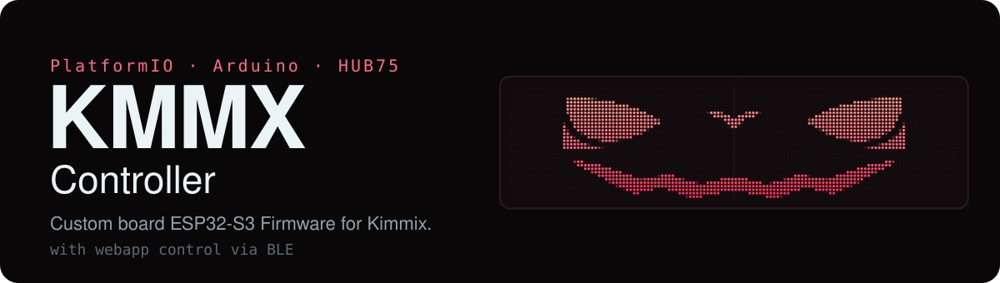
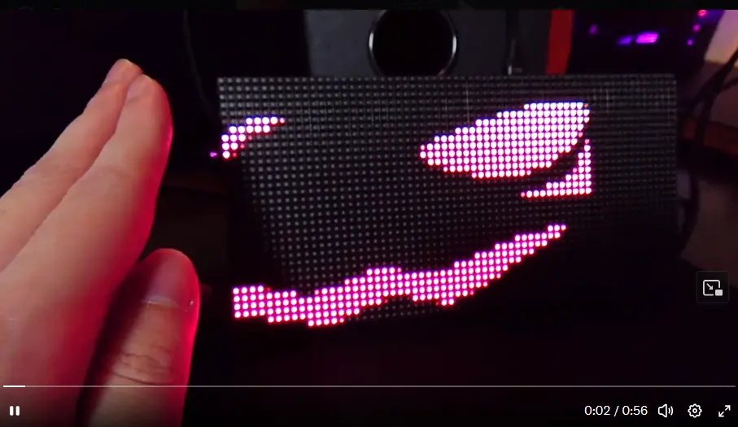
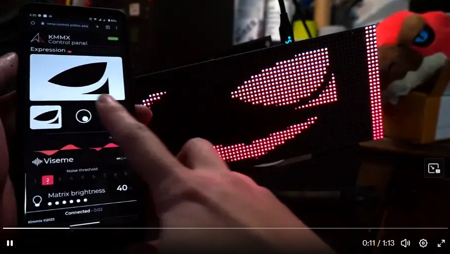
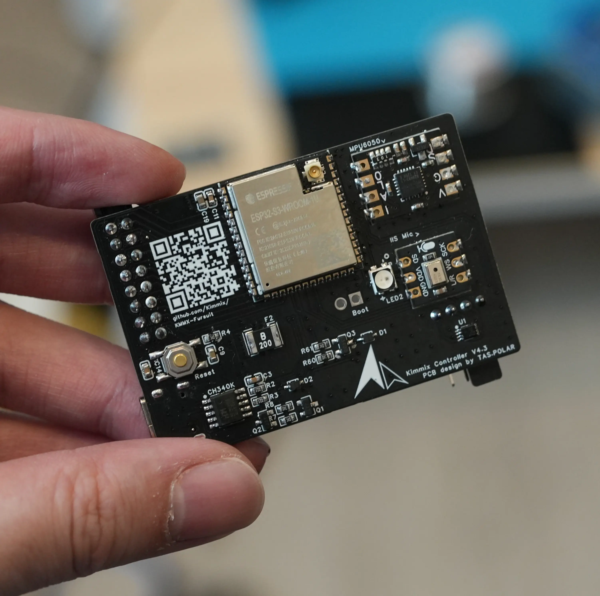
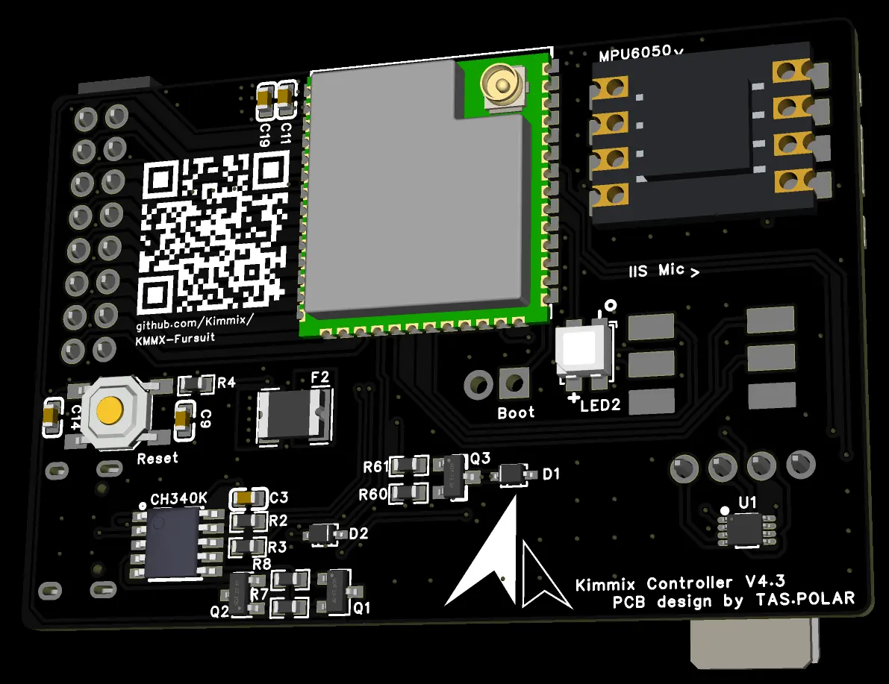
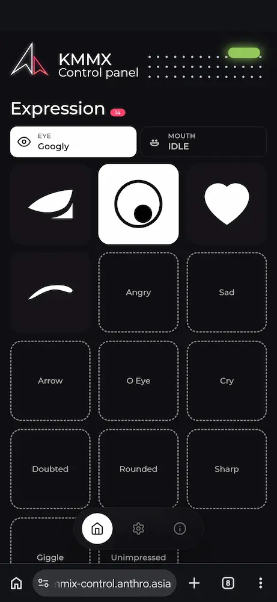

<div align="center">



[](LICENSE)
[](https://www.espressif.com/en/products/socs/esp32s3)
[](https://platformio.org/)
[](https://github.com/Kimmix/KMMX-Controller)

</div>

> [!NOTE]
> A personal project built for my own fursuit. MIT-licensed, so fork and adapt it freely, but **no support, no pull requests, and APIs may change without notice.**

## Demo

<table>
<tr>
<td align="center" width="50%"><br><b>Booping</b><br><a href="https://x.com/kimmix00/status/1687878110430339072/video/1">Watch on X</a></td>
<td align="center" width="50%"><br><b>Bluetooth control</b><br><a href="https://x.com/kimmix00/status/1704465522497397001/video/1">Watch on X</a></td>
</tr>
</table>

## Features

- **Animated eyes and mouth** on HUB75 LED matrices: blinking, emotes, custom bitmap expressions
- **Audio-reactive visemes** from an I2S microphone
- **Boop sensing** with an APDS9930 or VL6180X proximity sensor
- **Motion reactions** from a LIS3DH (V2) or MPU6050 (V4) IMU
- **BLE control** of expressions, brightness, colours, fan and settings; see [BLE_INTERFACE.md](BLE_INTERFACE.md)
- **Extras:** WS2812/SK6812 accent LEDs, SSD1306 OLED HUD, PWM fan (V4)

## Expressions

Eyes and mouths are 8-bit grayscale bitmaps in `src/Bitmaps/`, animated frame by frame and mirrored onto the second panel.

| | Available |
| --- | --- |
| **Eyes** | default, angry, arrow, blink, circle, cry, doubted, giggle, look sharp, rounded, sad, sharp, sleep, smile, unimpressed, up |
| **Mouths** | default, angry, drooling, eh, lower, pout, shock, small, wah, worry |
| **Visemes** | AH, EE, OH, OO, TH, picked from the microphone's frequency bands |
| **Effects** | blush, flying hearts, weeping tears, googly eyes driven by the IMU, glitch |

## Reactions

| Trigger | Response |
| --- | --- |
| Boop (proximity) | boop animation, hearts |
| Tap | glitch effect |
| Repeated pats | smile |
| Head tilt | expression change |
| Held upside down | crying |
| Speech (I2S mic) | live lip-sync with visemes |

Each motion trigger can be switched on or off over BLE.

## Display colours

The default is a coral-to-pink vertical gradient (`#FFA393` to `#FF2B5B`), the one used in the hero above. Six colour modes are selectable over BLE:

| Mode | Effect |
| --- | --- |
| 0 | Gradient (default, two custom colours) |
| 1 | Spiral / vortex, rainbow cycling |
| 2 | Plasma interference pattern |
| 3 | Radial pulse from the eye centres |
| 4 | Dual spiral |
| 5 | Dual circle |

The side LED strip has its own brightness and colours, defaulting to `#FF446C` with a `#F9826C` wave. Horn brightness is set separately.

## Slot machine

A small game mode for the face: enable it over BLE, and each completed boop spins three reels. Wins flash the horn LED.

## Bluetooth

The controller advertises a single GATT service with about 25 characteristics: brightness, colour modes, eye and mouth state, viseme tuning, LED colours, motion flags, glitch, orientation, slot machine and (V4) fan speed. Writes need an encrypted, bonded link with a 6-digit passkey. Full spec: [BLE_INTERFACE.md](BLE_INTERFACE.md).

## V2 and V4

| | V2 | V4 |
| --- | --- | --- |
| IMU | LIS3DH | MPU6050 |
| Status LED | WS2812 (IO45) | SK6812 (IO38) |
| Fan | none | PWM, 25 kHz |
| PSRAM | none | 8 MB |

## Hardware

Current target is **Controller V4**; V2 is still supported.

<div align="center">


</div>

Custom PCB designed in collaboration with [Tas.Polar](https://github.com/BaiTian6641).

| Part | Notes |
| --- | --- |
| Controller | KMMX V2/V4 ESP32-S3 board, or any ESP32-S3 with matching pin changes |
| Display | HUB75 panels, 64x32 recommended |
| Proximity | APDS9930 or VL6180X (optional) |
| IMU | LIS3DH (V2) / MPU6050 (V4) (optional) |
| Microphone | I2S module (optional) |
| LEDs / HUD / fan | WS2812 or SK6812, SSD1306 OLED, PWM fan (all optional) |
| Power | 5V, sized for your panels |

## Build and flash

> [!WARNING]
> For experienced ESP32 / PlatformIO users. Pins and settings are specific to my hardware.

```bash
pio run -e KimmixControllerV4 -t upload     # V4 (debug)
pio run -e KimmixControllerV4-release -t upload   # V4 (release, no serial logging)
pio run -e KimmixControllerV2 -t upload     # V2 (debug)
```

Where to configure things:

- Pins: `boards/kmmx-protogen-v*pins.h`
- Matrix, animation, sensor and feature flags: `src/config.h`
- Drivers: `src/Devices/`
- BLE service and characteristics: [BLE_INTERFACE.md](BLE_INTERFACE.md)
- Bitmap headers live in `src/Bitmaps/`; the generator tool is private and not included.

Host-side tests (no board needed) cover boop, fan PWM, viseme scoring and the startup queue:

```bash
python tests/run_host_tests.py
```

<details>
<summary>Project layout</summary>

- `src/` firmware: `Bitmaps/`, `Devices/`, `FacialStates/`, `Games/`, `KMMXController/`, `Network/`, `Renderer/`, `Types/`, `Utils/`, `config.h`, `main.cpp`
- `boards/` custom board definitions and pin maps
- `scripts/` PlatformIO build patches for the HUB75 library
- `tests/` host-side tests (boop, fan PWM, viseme scoring)
- `doc/` images

</details>

## Web control panel

Control the suit from a phone or laptop over Web Bluetooth (Chrome/Edge), no app install.

<div align="center">


**[Live demo](https://kimmix-control.anthro.asia)** · **[Source: KMMX-ControlPanel](https://github.com/Kimmix/KMMX-ControlPanel)**
</div>

Change expressions, adjust brightness and colours, and tweak controller settings remotely.

## License and contact

[MIT](LICENSE): use, modify and distribute freely, with no warranty.

Discord: `kimmix` · Web: [kimmix.anthro.asia](https://kimmix.anthro.asia/)
